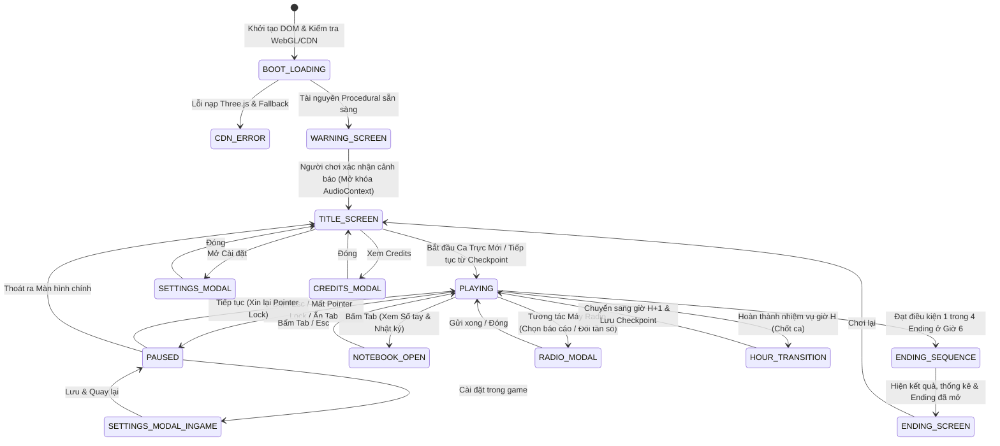
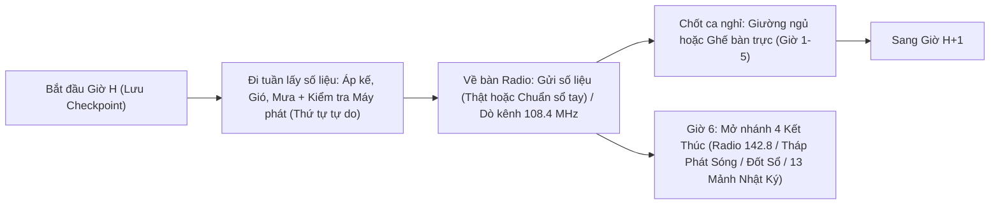

# THIẾT KẾ KỸ THUẬT & KIẾN TRÚC HỆ THỐNG: TRẠM 9

## 1. KIẾN TRÚC MODULE (CODE ARCHITECTURE)

Dự án được viết bằng JavaScript hiện đại (ES2022) kết hợp với **Three.js `v0.186.1`** (phiên bản ổn định mới nhất đã kiểm tra trên npm/jsDelivr). Source code được tách thành các module độc lập trong thư mục `src/` và đóng gói sang `dist/` (đồng thời hỗ trợ chạy trực tiếp ở cả `index.html` gốc lẫn `dist/index.html` qua giao thức `file://` và `http://`).

```
/home/dat.cao/side-projects/horror/
├── index.html          # File chạy chính (chạy trực tiếp bằng file:// hoặc static server)
├── dist/
│   ├── index.html      # Bản đóng gói tự chứa (single-file bundle cho itch.io / file://)
│   └── bundle.js       # Bản bundle IIFE được tạo từ src/main.js
├── vendor/
│   └── three.min.js    # Bản sao cục bộ Three.js v0.186.1 (fallback khi CDN mất mạng / file://)
├── build.mjs           # Script đóng gói từ src/* sang dist/bundle.js và dist/index.html
├── src/
│   ├── config.js       # Toàn bộ hằng số cân bằng game, thông số đồ họa, kịch bản số liệu, đa ngôn ngữ
│   ├── save.js         # Quản lý localStorage (bọc try/catch), lưu checkpoint mỗi giờ, ending đã mở, settings
│   ├── audio.js        # Tổng hợp âm thanh thủ tục bằng Web Audio API + HRTF PannerNode + Bước chân trễ
│   ├── input.js        # Quản lý bàn phím, chuột, Pointer Lock API, raycast tương tác, hỗ trợ tay cầm cơ bản
│   ├── renderer.js     # Khởi tạo WebGLRenderer, RenderTarget, Single-Pass Post-Processing Shader, DRS, Debug
│   ├── world.js        # Dựng hình học Trạm 9 (InstancedMesh, gộp geometry tĩnh, texture procedural, đèn)
│   ├── entity.js       # Logic Kẻ Đo: Hiện diện ngoại vi (Peripheral Presence) + Ghi & phát lại lộ trình (Routine Learning)
│   ├── story.js        # Máy trạng thái 6 giờ trực, 13 quy tắc, 13 mảnh nhật ký, Radio 2 tần số, 4 Ending
│   ├── ui.js           # Quản lý DOM UI: Màn cảnh báo, Title, Sổ tay (Tab), Phụ đề, Pause, Settings, Ending, Debug (F3)
│   └── main.js         # Điểm vào ứng dụng, vòng lặp Fixed Timestep, kết nối các hệ thống & xử lý sự kiện biên
├── SCRIPT.md           # Kịch bản chi tiết, nhân vật, 13 quy tắc, 13 mảnh nhật ký, 4 kết thúc
├── DESIGN.md           # Tài liệu kiến trúc kỹ thuật & ngân sách hiệu năng
├── DECISIONS.md        # Nhật ký quyết định thiết kế và kỹ thuật
└── CREDITS.md          # Ghi công thư viện, giấy phép và xác nhận nguồn tài nguyên
```

### Nguyên tắc giao tiếp giữa các module
- Không dùng biến toàn cục rải rác trên `window` (ngoại trừ `window.THREE` cho tương thích `file://` và `window.__TRAM9_DEBUG__` phục vụ kiểm thử tự động).
- Mọi con số cân bằng (tốc độ đi bộ, góc nhìn ngoại vi, thời gian bước chân trễ, ngưỡng áp suất, màu sắc đèn, thông số từng giờ) đều tập trung tại `src/config.js`.
- Vòng lặp cập nhật logic (`update(dt)`) sử dụng **Fixed Timestep** (`FIXED_DT = 1 / 60` giây, clamp `rawDelta <= 0.1` giây) tách biệt với bước vẽ (`render()`).

---

## 2. NGÂN SÁCH HIỆU NĂNG (PERFORMANCE BUDGET)

| Hạng mục | Ngưỡng tối đa cho phép | Thiết kế thực tế của Trạm 9 | Giải pháp kỹ thuật áp dụng |
| :--- | :--- | :--- | :--- |
| **Tốc độ khung hình (FPS)** | 60 FPS (Medium 1080p iGPU) / >= 30 FPS (Low) | 60 FPS ổn định | Fixed timestep, Dynamic Resolution Scaling (DRS), cắt giảm pass hậu kỳ |
| **Draw Calls** | <= 150 lệnh vẽ / frame | **35 – 75 draw calls** | Dùng `THREE.InstancedMesh` cho cọc rào, cây thông sương, đá tảng, nan gió; gộp các mảng tường/sàn cùng vật liệu |
| **Số tam giác (Triangles)** | <= 250.000 tris / frame | **12.000 – 32.000 tris** | Hình khối kiến trúc low-poly tối ưu, frustum culling mặc định, sương mù `FogExp2` kết hợp cắt `camera.far = 55m` |
| **Đèn động (Dynamic Lights)** | <= 4 đèn động, tối đa 1 đèn đổ bóng | **4 đèn động (1 Shadow Light)** | `HemisphereLight` (nền) + `SpotLight` đèn pin người chơi (đổ bóng duy nhất ở High/Med) + `PointLight` đèn natri sân & đèn bàn trong trạm. Toàn bộ vùng tối/sáng còn lại dùng texture lightmap/AO vẽ bằng Canvas 2D và màu tự phát sáng (`emissive`) |
| **Post-Processing** | Ít pass nhất có thể | **Đúng 1 Pass duy nhất** | Render cảnh vào `WebGLRenderTarget` -> Vẽ qua 1 `ShaderMaterial` tích hợp: (1) Color Grading 16mm xanh xám, (2) Vignette, (3) Film Grain, (4) Chromatic Aberration nhẹ ở rìa, (5) Hiệu ứng bóng nhiễu & méo quang học của **Kẻ Đo ở ngoại vi tầm nhìn** |
| **Cấp phát trong vòng lặp** | 0 đối tượng mới / frame | **0 cấp phát (`new`) trong `tick()`** | Khai báo sẵn các biến tạm (`_tmpVec3A`, `_tmpVec3B`, `_tmpQuat`, `_tmpMat4`, `_raycaster`) ở đầu mỗi module và tái sử dụng |
| **Tỉ lệ điểm ảnh (Pixel Ratio)** | Tối đa 2.0 | Low: `0.85`, Med: `min(dpr, 1.5)`, High: `min(dpr, 2.0)` | Kèm bộ điều chỉnh DRS tự động hạ thang phân giải từ `1.0` xuống `0.65` nếu thời gian frame vượt `20ms` liên tục |
| **Dung lượng tải ban đầu** | < 2.0 MB | **~820 KB tổng cộng** | Toàn bộ texture và âm thanh được sinh thủ tục (procedural) bằng code lúc khởi tạo (< 300ms), không tải file âm thanh/model nặng từ mạng |

---

## 3. THIẾT KẾ HAI CƠ CHẾ CỐT LÕI (CORE MECHANICS)

### A. Hiện Diện Ngoại Vi (Peripheral Presence)
Kẻ Đo không dùng mẹo đổi model đơn giản mà kết hợp giữa **hình học bán trong suốt biến thiên theo tích vô hướng góc nhìn** và **shader hậu kỳ (Post-Processing GPU Shader)**:
1. **Tính toán góc lệch tâm (View Angle Dot Product):**
   - Trong mỗi bước logic, lấy vector hướng nhìn của camera $\vec{F}$ và vector hướng từ camera tới thực thể $\vec{D} = \text{normalize}(\vec{P}_{\text{entity}} - \vec{P}_{\text{camera}})$.
   - Góc lệch chuẩn hóa: $d = \vec{F} \cdot \vec{D}$ (với $d = 1.0$ là nhìn thẳng tâm màn hình, $d \in [0.35, 0.86]$ là vùng rìa tầm nhìn, $d < 0.25$ là ngoài khung hình).
2. **Phản ứng của Thực thể & Shader:**
   - **Khi ở vùng ngoại vi ($0.38 \le d \le 0.88$):** Độ rõ (`peripheralAlpha`) đạt cực đại ở $d \approx 0.62$ (rìa màn hình). Shader hậu kỳ tạo vùng nhiễu hạt dọc, lệch sắc độ và làm hiện rõ hình dáng cao gầy của Kẻ Đo ở đúng tọa độ màn hình chiếu (`projectedUV`) của thực thể.
   - **Khi người chơi quay thẳng mắt nhìn vào ($d > 0.88$):** Độ rõ của thực thể tan nhanh vào sương (`alpha -> 0`), nhưng cờ `wasLookedDirectly` được bật. Ngay khoảnh khắc người chơi quay mặt đi ($d$ giảm xuống dưới $0.70$), thực thể lập tức dịch chuyển tiến sát người chơi thêm $2.2\text{m}$ theo hướng tiếp cận và tăng chỉ số `assimilationScore`.

### B. Học Thói Quen (Routine Learning & Echo Stalker)
1. **Thu thập dữ liệu (`RoutineRecorder`):**
   - Mỗi `0.25` giây trong giờ trực $H$, hệ thống ghi vào mảng vòng (ring buffer) có sẵn các mẫu `{ x, z, yaw, speed, actionType, timestamp }`.
   - Ghi nhận **Thứ tự ghé trạm** (`stationOrder`: ví dụ `['barometer', 'anemometer', 'rain_gauge', 'generator', 'radio']`) và **Điểm dừng lâu** (`dwellNodes`: các tọa độ mà tốc độ $< 0.2\text{m/s}$ kéo dài quá 4 giây).
   - So sánh lộ trình giờ $H$ với giờ $H-1$ để tính chỉ số **Độ đoán trước thói quen** (`routinePredictability` từ `0.0` đến `1.0`).
2. **Phát lại & Đón đầu (`EchoStalker` từ Giờ 3):**
   - Một thực thể bóng sương (`EchoMesh`) đi theo quỹ đạo đã ghi của giờ trước nhưng lệch pha.
   - Nếu `routinePredictability > 0.65`, bóng sương chuyển từ chế độ *bám đuôi* (đi sau 1 nhịp) sang chế độ *đón đầu* (đứng đợi sẵn tại trạm đo kế tiếp theo thứ tự quen thuộc của người chơi).
   - **Âm thanh bước chân thứ hai:** Mỗi khi người chơi phát ra một tiếng bước chân tại thời điểm $t$, nếu Kẻ Đo đang bám theo, bộ tổng hợp âm thanh lập tức lên lịch (`AudioContext.currentTime + 0.34`) phát một tiếng bước chân thứ hai thông qua `PannerNode` đặt ở vị trí lệch sau lưng người chơi $2.5\text{m}$ – $4.5\text{m}$. Khi người chơi dừng lại 3 giây hoặc rẽ ngoặt $90^\circ$ (theo Quy tắc 2), hàng đợi bước chân trễ bị cắt và bóng lặp tan đi.

---

## 4. DANH SÁCH ASSET (100% PROCEDURAL GENERATION)

Toàn bộ tài nguyên được tạo thủ tục bằng code để đảm bảo: (1) Tải cực nhanh, (2) Chạy hoàn hảo qua `file://` không lo lỗi CORS hình ảnh/âm thanh, (3) Không phụ thuộc bản quyền bên thứ ba.

### 4.1. Procedural Textures (Vẽ trên HTML5 Canvas 2D -> `THREE.CanvasTexture`)
1. `texConcreteWall` (`512x512`): Tường bê tông trạm khí tượng ẩm mốc, có vệt nước mưa và giả lập Ambient Occlusion (AO) ở chân tường/trần.
2. `texWoodFloor` (`512x512`): Sàn ván gỗ thông cũ có vân gỗ và khe ghép ván.
3. `texMetalPanel` (`512x512`): Vỏ thép máy phát điện, tủ sắt, cửa chống bão có đinh tán và vết gỉ sét.
4. `texGroundSnowMud` (`512x512`): Mặt đất sỏi đá cao nguyên phủ sương muối bên ngoài Sân Đo.
5. `texDialGauge` (`256x256`): Mặt đồng hồ đo Áp kế, Phong vũ biểu, Vũ lượng kế, Nhiệt kế với vạch chia độ rõ nét.
6. `texPaperNote` (`256x256`): Bề mặt giấy ố vàng kẹp ghim đồng của 13 mảnh nhật ký.

### 4.2. Procedural 3D Models (Dựng bằng Geometry gộp & InstancedMesh)
1. **Nhà Trạm Chính:** Phòng Radio (Bàn điều khiển, máy bộ đàm 2 tần số, ghế xoay, cửa sổ kính nhìn ra hành lang), Hành lang chính (Kệ sắt, bàn ăn, cốc tráng men, cửa chính có ô kính), Phòng Ngủ (Giường sắt, chăn gối, bàn đầu giường, nhiệt kế treo tường), Phòng Máy Phát Điện (Khối động cơ diesel, cần gạt tải, bảng cầu dao, Lò đốt mẫu khí tượng có cửa lửa, cửa hông ra sân).
2. **Sân Quan Trắc (Yard):** Hàng rào lưới/cọc sắt (`InstancedMesh`), 4 cột đèn hơi natri vàng cam, Lều khí tượng Stevenson chứa Áp kế, Trụ Phong vũ biểu (cánh quay đo gió động), Trụ Vũ lượng kế, Tháp Phát Sóng Cao Tần ở cuối sân (có cổng khóa mã và cần gạt phát sóng), rừng thông đen và đá tảng bao quanh trong sương (`InstancedMesh`).
3. **Kẻ Đo & Bóng Lặp:** Hệ lưới hình nhân cao gầy biến dạng nhẹ theo sóng sin trong vertex/material kết hợp hạt sương bao quanh.

### 4.3. Procedural Audio (Tổng hợp bằng Web Audio API)
1. **Drone nền & Không khí:** Bộ dao động sóng răng cưa/sin tần số thấp (`42Hz` & `63Hz`) đi qua `BiquadFilterNode` lowpass điều biến chậm.
2. **Tiếng gió cao nguyên:** Buffer nhiễu trắng/hồng (`Noise Buffer`) lọc qua `BiquadFilterNode` bandpass có tần số cắt lượn sóng theo cường độ gió từng giờ (tắt lặng ở Giờ 4, rít mạnh ở Giờ 5).
3. **Tiếng máy phát điện Diesel:** Chuỗi xung tần số thấp (`24Hz`) kết hợp cộng hưởng buồng máy gắn với `PannerNode` đặt tại tọa độ Phòng Máy Phát.
4. **Tiếng Radio & Tín hiệu Morse/Thoại tổng hợp:** Nhiễu tĩnh trắng + sóng formant mô phỏng âm sắc giọng nói qua bộ đàm sóng ngắn.
5. **Tiếng bước chân (Người chơi & Kẻ Đo):** Tổng hợp xung ngắn + lọc cộng hưởng khác nhau cho 3 bề mặt: Sàn gỗ (`wood`), Bê tông (`concrete`), Sỏi đá ngoài sân (`gravel`), kèm hệ thống phát trễ 0.35s qua `PannerNode` 3D cho bước chân thứ hai.
6. **Nhịp tim & Cú hù (Stinger):** Sóng sin trầm `55Hz` kép cho nhịp tim và hợp âm đồng thau bất hòa có kiểm soát qua `DynamicsCompressorNode` (chống vỡ tiếng).

---

## 5. SƠ ĐỒ MÁY TRẠNG THÁI (STATE MACHINE)

### 5.1. Máy trạng thái luồng ứng dụng (`AppState`)



### 5.2. Máy trạng thái trong mỗi giờ trực (`HourTaskState`)


